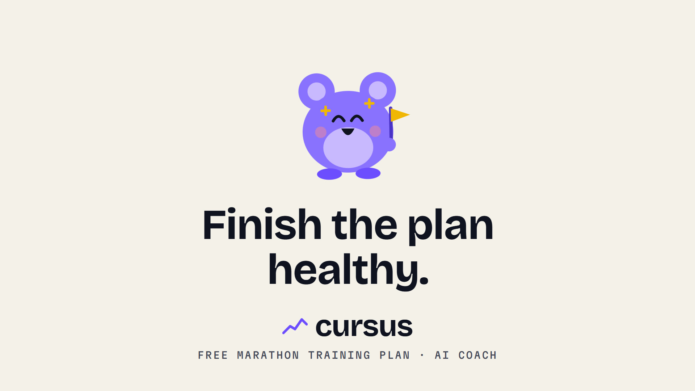
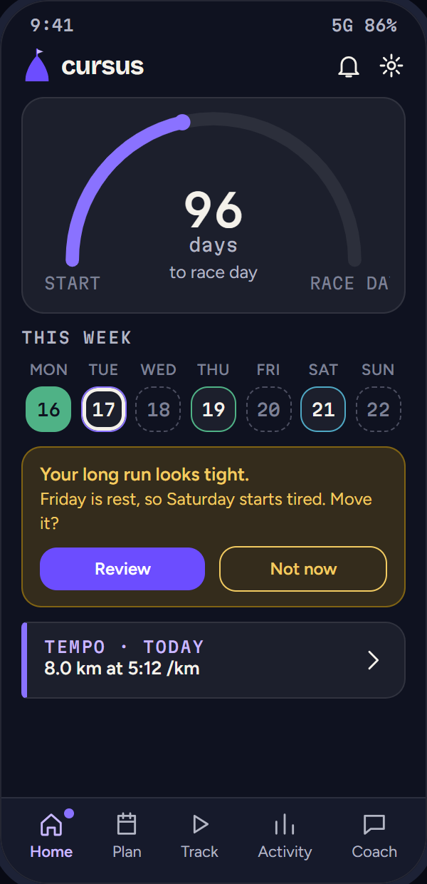
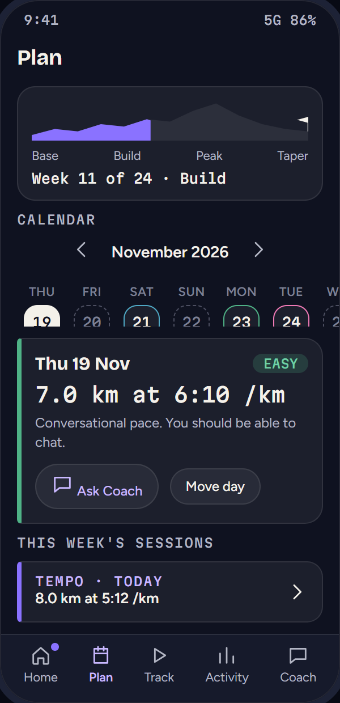
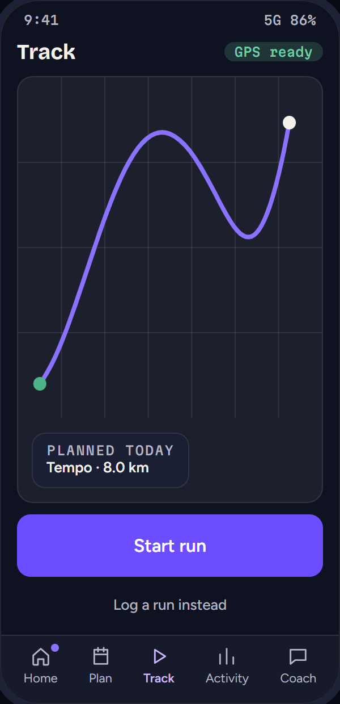
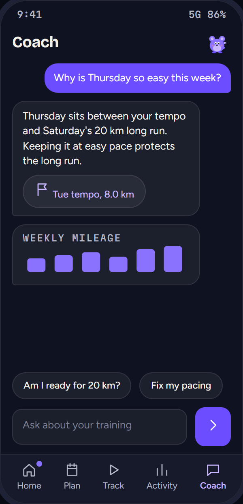
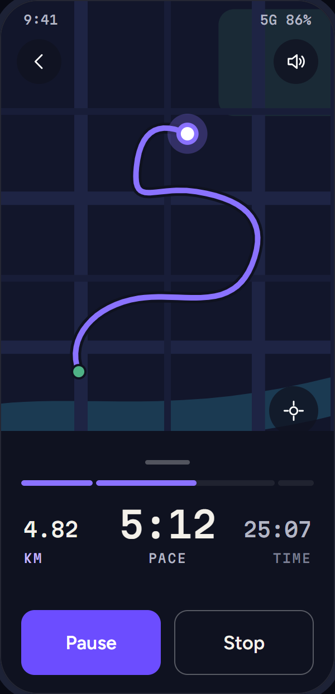
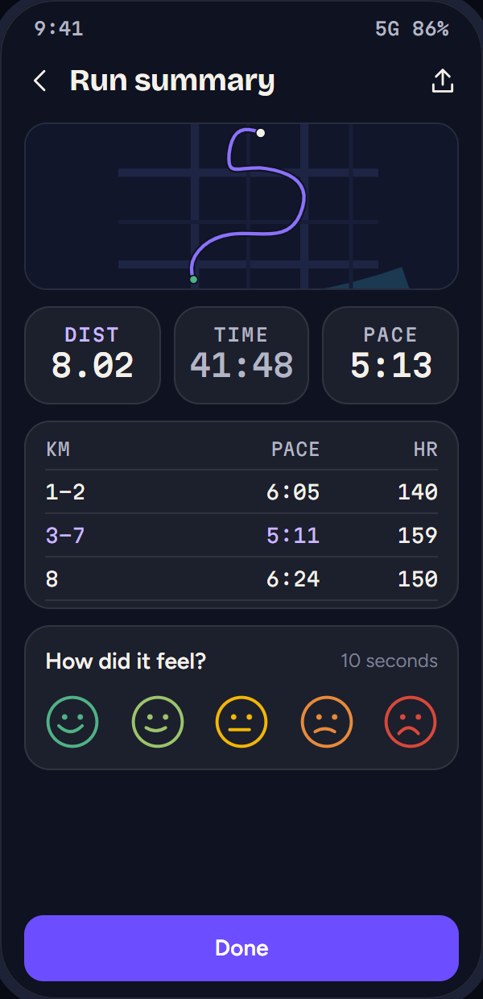
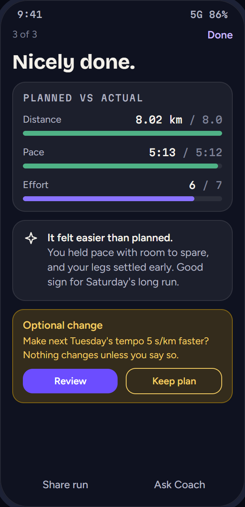
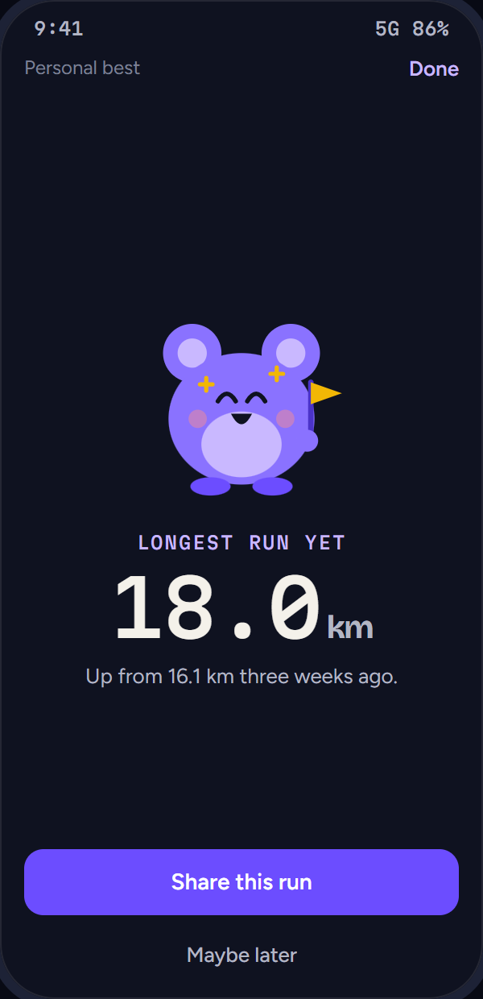

<p align="center">
  
</p>

<h1 align="center">Cursus</h1>

<p align="center"><b>Your marathon is a line.</b><br>
A free marathon training app: a personal plan built from your race goal, GPS run tracking, and an AI coach that explains your training without ever inventing the numbers.</p>

<p align="center">
  <a href="docs/media/cursus-promo.mp4">
    
  </a>
  <br>
  <sub>▶ <a href="docs/media/cursus-promo.mp4">Watch the 20-second promo video</a></sub>
</p>

> **Renamed.** The app was called *Stryde* until November 2026. It is now **Cursus** (Latin for "course" or "run"), with a new violet identity, new fonts, a "profile line" logo and a mascot called Pika. A few internal names still say `stryde` on purpose (see [Naming notes](#naming-notes)).

---

## Contents

1. [What it is](#what-it-is)
2. [The one idea behind it](#the-one-idea-behind-it)
3. [Features](#features)
4. [How a runner uses it](#how-a-runner-uses-it)
5. [Screens](#screens)
6. [Architecture](#architecture)
7. [Tech stack](#tech-stack)
8. [Design system](#design-system)
9. [Project structure](#project-structure)
10. [Getting started](#getting-started)
11. [Scripts](#scripts)
12. [Testing and quality](#testing-and-quality)
13. [Backend: database and Edge Functions](#backend-database-and-edge-functions)
14. [Building and releasing](#building-and-releasing)
15. [Documentation map](#documentation-map)
16. [Project status](#project-status)
17. [Naming notes](#naming-notes)

---

## What it is

Cursus is a mobile app (Android first, React Native with Expo) for **self-coached recreational runners** who are training for a marathon or half marathon without paying for a coach or a subscription.

A runner sets a race, a goal and the days they can train. Cursus builds a periodised plan (base, build, peak, taper), shows today's session on Home, records the run with GPS, and lets the runner ask an AI coach questions about their own training. After each run there is a short reflection, and the app suggests small, safe changes to the plan, but only if the runner agrees.

It is free to use and runs entirely on free-tier infrastructure.

## The one idea behind it

> **Rules produce the numbers. AI explains them.**

Every training number a runner sees (pace zones, weekly volume, session distances, the taper) comes from a **deterministic, unit-tested rule engine** in `lib/planEngine`. The AI coach never generates a training number. It reads the runner's data and the plan, then explains and contextualises them in plain language. If the model returns a weekly-mileage figure, the app replaces it with the engine's value afterwards instead of trusting the model.

Two other product rules follow from this:

- **Plan changes are only proposed, never applied automatically.** The runner confirms every adjustment.
- **Never judgemental.** A missed or slow session is stated neutrally. Red is reserved for destructive actions, never for a missed run.

## Features

| Area | What you get |
|---|---|
| **Personalised plan** | Plan generated from race distance, goal time, training days and real history. Periodised base, build, peak and taper, with adaptive volume progression and a beginner safety gate. Paces come from a race result, a target time or a Riegel prediction. |
| **Session types** | Easy, tempo, interval, long run and race day, each with its own colour, prep and recovery notes, and an interval structure (reps, recovery) shown in the UI. |
| **Plan-ready onboarding** | A short onboarding flow ends on a "your plan is ready" screen that summarises the block (weeks, peak week, finish-time range) before the first run. |
| **Run tracking** | Live GPS with accuracy and plausible-movement filtering, background tracking with the screen off, voice cues (distance, pace, off-pace warnings, interval legs), pause and resume, and **hold-to-stop** so a pocket tap cannot end a run. A finished-but-unsaved run survives the app being killed. |
| **Manual logging and import** | Log a run by hand, or import from Health Connect on Android. |
| **Post-run reflection** | After saving a run: how it felt (a face from easy to max), effort, body and conditions chips, a note, and a rules-based insight. A pace nudge of 3 s/km (capped at 6) is offered only when it is safe, and never after a niggle. |
| **Personal bests** | A short celebration when a run sets a record (longest run, fastest 5K, 10K and half marathon). |
| **AI coach** | Chat grounded in the runner's own logged data and a curated training-science knowledge base. Hybrid retrieval (Postgres full-text plus pgvector similarity), live web search for real-world facts, and a two-provider LLM fallback (Gemini, then Groq). |
| **Calendar and plan view** | The plan's terrain ("Block Profile"), a month-slider calendar coloured by run type, and a selected-day card with *Ask Coach* and *Move day*. Missed sessions get inline *Move to tomorrow* and *Mark done anyway*. |
| **Trends and history** | Activity history, pace and mileage trends, consistency, gear tracking with retirement nudges. |
| **Race day** | Readiness summary, weather for the race city (Open-Meteo), and a full pace band. |
| **Share and export** | Shareable run cards, plus GPX and TCX export. |
| **Notifications** | A daily morning message with the day's session, with the send time set by the runner. |
| **Access control** | Manual waitlist approval with an admin screen. No public sign-up to access flow yet. |
| **Pika, the mascot** | A small mountain goat who appears only at calm or good moments: onboarding, plan ready, empty states, reflection, personal bests, notifications and the splash. Never during a run, on errors, pain flags, missed runs or a paywall. |

## How a runner uses it

```
Sign up ─► Waitlist approval ─► Onboarding ─► Plan ready ─► Home
                                 (race target,            │
                                  location, fitness,      ▼
                                  calibration, days,   Today's session
                                  health data)            │
                                                          ▼
                                       Track a run (GPS, voice cues, hold-to-stop)
                                                          │
                                                          ▼
                              Run summary ─► Reflection ─► Insight ─► Personal best?
                                                          │
                                                          ▼
                              Plan proposes a small change ─► runner accepts or declines
```

## Screens

Cursus ships in light and dark. **Active Run and Track are always dark**, in both themes, because they are read outdoors, mid-stride. These are renders from the design mockup (`docs/cursus-design.html`, 48 screens in light and dark; all renders are in [`docs/mockup-shots/`](docs/mockup-shots)).

<table>
  <tr>
    <td align="center"><br><sub><b>Home</b><br>countdown arc, this week, today's session</sub></td>
    <td align="center"><br><sub><b>Plan</b><br>terrain, month slider, selected day</sub></td>
    <td align="center"><br><sub><b>Track</b><br>always dark, one big Start</sub></td>
    <td align="center"><br><sub><b>Coach</b><br>grounded in your own data</sub></td>
  </tr>
  <tr>
    <td align="center"><br><sub><b>Active run</b><br>pace, distance and time at a glance</sub></td>
    <td align="center"><br><sub><b>Run summary</b><br>splits, map, stats</sub></td>
    <td align="center"><br><sub><b>Reflection</b><br>a rules-based insight</sub></td>
    <td align="center"><br><sub><b>Personal best</b><br>Pika celebrates</sub></td>
  </tr>
</table>

## Architecture

```
┌──────────────────────────────┐        ┌──────────────────────────────────────┐
│  Cursus app                  │        │  Supabase                            │
│  React Native · Expo Router  │        │                                      │
│                              │  RLS   │  Postgres  (RLS on every table,      │
│  lib/planEngine  (pure TS)   ├───────►│            pgvector, pg_cron)        │
│  lib/runTracking (GPS, voice)│        │  Auth      (Google, email)           │
│  lib/reflection  (rules)     │        │  Storage   (run photos)              │
│  components/ · app/ screens  │        │                                      │
└───────────────┬──────────────┘        │  Edge Functions (Deno)               │
                │                       │   • coach-chat                       │
                │ Health Connect        │   • generate-run-script              │
                ▼                       │   • send-daily-notification          │
        Android phone sensors           │   • admin-set-approval               │
        (GPS, Health Connect)           └──────────────┬───────────────────────┘
                                                       │
                          Gemini (LLM + embeddings) · Groq (fallback) · Tavily (web search)
                          Open-Meteo · Firebase Cloud Messaging · Google Maps · Sentry
```

Key decisions:

- **The plan engine has no dependencies and no I/O.** `lib/planEngine` is plain TypeScript, so it is easy to test and can be tried from the command line (`npm run plan:try`).
- **The client talks to Postgres directly, protected by Row Level Security.** Only the public anon key ships in the app. The service-role key is used only by local scripts.
- **The coach lives in an Edge Function**, so provider keys never reach the device. It retrieves with hybrid search, calls Gemini first and falls back to Groq, and the engine's numbers are patched back in after generation.
- **Offline-first saving.** A finished run is persisted locally before it is uploaded, so it survives a crash or the app being killed.
- **Free tier by design.** Nothing in the design depends on a paid service.

## Tech stack

| Layer | Technology |
|---|---|
| App | React Native 0.86, React 19, Expo SDK 57 (Router, Location, Task Manager, Speech, Notifications, Sharing), TypeScript, `react-native-svg`, `react-native-maps` |
| Backend | Supabase: Postgres (Row Level Security, `pgvector`, `pg_cron`), Auth, Storage, Edge Functions (Deno) |
| AI | Gemini (primary LLM and `gemini-embedding-001`), Groq (fallback LLM), Tavily (web search) |
| Other services | Google Maps, Firebase Cloud Messaging, Health Connect, Open-Meteo, Sentry |
| Fonts | Bricolage Grotesque, Figtree, Martian Mono (via `@expo-google-fonts`) |
| Tooling | Jest (`jest-expo`), EAS Build, Supabase CLI |

## Design system

The identity is **the profile line**: a training block drawn as terrain, rising through build and peak and falling through taper to a flag. The logo, the plan terrain and the home countdown all use that one line.

| Token | Value | Used for |
|---|---|---|
| Ink | `#0F1220` | Dark ground, text on light |
| Bone | `#F4F1EA` | Light ground, text on dark |
| Ultraviolet | `#6C4DFF` | The single call to action, tempo runs |
| Glacier | `#1F6F8B` | Long runs, secondary actions |
| Moss | `#4FB286` | Easy runs, on target, completed |
| Rose | `#C23B87` | Interval sessions |
| Marigold | `#F2B705` | Plan-adjustment prompts, race day |

Type: **Bricolage Grotesque** for titles, **Figtree** for reading, **Martian Mono** for every number and uppercase label.

Rules worth knowing: one violet action per screen; text colours use separate "text role" tokens so every pairing passes WCAG AA (a test guards both themes); cards are flat with a 1px hairline and no shadow; every size comes from a pinned type scale.

Where to read more: [`marathon-app/DESIGN.md`](marathon-app/DESIGN.md) (the written system), [`marathon-app/PRODUCT.md`](marathon-app/PRODUCT.md) (users, principles, brand commitments), [`docs/design.md`](docs/design.md), [`docs/cursus-design.html`](docs/cursus-design.html) (the 48-screen mockup) and [`docs/brand/cursus-final/`](docs/brand/cursus-final) (logo, mark, Pika, icons).

## Project structure

```
.
├── marathon-app/                 The React Native / Expo app
│   ├── app/                      Screens (Expo Router, file-based)
│   │   ├── (auth)/               Sign in, sign up, forgot password
│   │   ├── (tabs)/               Home, Plan, Track, Activity, Coach
│   │   ├── onboarding/           Race target to plan-ready flow
│   │   └── …                     Active run, run summary, reflect, settings, etc.
│   ├── components/               Shared UI (ui/, mascot/, onboarding/, reflection/)
│   ├── lib/
│   │   ├── planEngine/           Pure training-plan generator
│   │   ├── runTracking/          GPS task, voice cues, run state
│   │   ├── reflection/           Feel, effort, insight and pace-nudge rules
│   │   ├── coach/                Client for the coach Edge Function
│   │   ├── data/                 Supabase queries
│   │   ├── theme.ts, theme/      Design tokens (light and dark)
│   │   └── …                     Export (GPX/TCX), health, weather, units
│   ├── supabase/
│   │   ├── functions/            coach-chat, generate-run-script,
│   │   │                         send-daily-notification, admin-set-approval
│   │   └── migrations/           31 SQL migrations
│   ├── scripts/                  Plan CLI, knowledge-base seeding, coach benchmark
│   ├── assets/                   Icons, splash, fonts config
│   ├── eas.json, app.json        Build and app configuration
│   └── DESIGN.md, PRODUCT.md     Design system and product brief
└── docs/
    ├── plan/                     Main plan, per-task sub-plans, implementation logs, benchmarks
    ├── media/                    Promo video and screens used in this README
    ├── mockup-shots/             Rendered mockup, every screen in light and dark
    ├── brand/                    Logo, mark, Pika and icon sources
    ├── cursus-design.html        The full interactive mockup
    ├── cursus-docs.html          Engineering write-up (HTML)
    └── Cursus-Engineering-Docs.pdf  The same write-up as a PDF
```

## Getting started

You need a recent Node.js (20 or newer is a safe choice), a Supabase project, and (for the AI features) a Gemini API key. An Android phone or emulator is needed for GPS and Health Connect; the web preview works for most screens.

```bash
git clone https://github.com/Jaykumar93/MarathonApp.git
cd MarathonApp/marathon-app
npm install
cp .env.example .env      # fill in your Supabase URL and anon key (see below)
npm start                 # Expo dev server; press w for web, a for Android
```

Environment variables (`marathon-app/.env`, see `.env.example` for the full comments):

| Variable | Needed for | Safe in the app? |
|---|---|---|
| `EXPO_PUBLIC_SUPABASE_URL` | Everything | Yes |
| `EXPO_PUBLIC_SUPABASE_ANON_KEY` | Everything (Row Level Security gates access) | Yes |
| `EXPO_PUBLIC_SENTRY_DSN` | Crash reporting (leave blank to disable) | Yes |
| `SUPABASE_SERVICE_ROLE_KEY` | Local seeding scripts only | **No, never ship it** |
| `GEMINI_API_KEY` | Local seeding scripts only | **No** |

To set up your own backend, apply the migrations and deploy the functions:

```bash
cd marathon-app
npx supabase login
npx supabase link --project-ref <your-project-ref>
npx supabase db push
npx supabase functions deploy coach-chat
npx supabase functions deploy generate-run-script
npx supabase functions deploy send-daily-notification
npx supabase functions deploy admin-set-approval
npm run coach:seed        # embed the coach's knowledge base
```

The Edge Functions read their provider keys (`GEMINI_API_KEY`, Groq, Tavily and so on) from Supabase secrets, never from the app.

## Scripts

Run these from `marathon-app/`.

| Command | What it does |
|---|---|
| `npm start` | Start the Expo dev server |
| `npm run web` | Start with the web preview |
| `npm run android` / `npm run ios` | Run a native build on a device or emulator |
| `npm test` | Run the unit test suite |
| `npm run plan:try` | Try the plan-generation engine interactively from the command line |
| `npm run coach:seed` | Seed or re-embed the AI coach's knowledge base |
| `npm run coach:benchmark -- "<label>"` | Time the coach against a fixed set of questions |
| `npm run design:check` | Run the Impeccable design linter against the running web app |
| `npx tsc --noEmit` | Type-check |

## Testing and quality

- **Unit tests:** 22 suites and 304 tests with Jest, covering the plan engine (paces, periodisation, distribution, adjustment), GPS statistics, route shape, pace band, trends, personal bests, reflection insight rules, voice scripts, GPX and TCX export, and notification scheduling.
- **Contrast test:** `lib/__tests__/themeContrast.test.ts` checks WCAG AA for every text and surface pairing in both light and dark.
- **Type-check:** `npx tsc --noEmit` is clean.
- **Design lint:** `npm run design:check` is clean on the sign-in and privacy-policy screens.
- **Accessibility target:** WCAG 2.2 AA, with accessible names on controls and layouts that survive larger system fonts.
- **Coach benchmarks:** timing and retrieval comparisons across the coach's evolution (full-text baseline, then hybrid RAG) are recorded in [`docs/plan/benchmarks/`](docs/plan/benchmarks).

## Backend: database and Edge Functions

**Database** (Supabase Postgres, 31 migrations in `marathon-app/supabase/migrations/`): `profiles` (including the waitlist approval and admin flags), `goals`, `plans`, `plan_sessions`, `activities` (with the reflection fields `feel`, `body_tags`, `condition_tags`, `reflected_at`), `shoes`, `notifications`, `push_tokens`, `coach_messages` and the coach's `knowledge_base` (full-text and vector columns). Row Level Security is on for every table, so a signed-in runner can only read and write their own rows.

**Edge Functions** (Deno):

| Function | Purpose |
|---|---|
| `coach-chat` | The AI coach: hybrid retrieval, web search when a question needs real-world facts, Gemini then Groq fallback, and the engine's weekly-mileage figure patched back in after generation |
| `generate-run-script` | Writes the voice script for a run's cues |
| `send-daily-notification` | The daily morning push with the day's session |
| `admin-set-approval` | Lets an admin approve or reject a waitlist request |

## Building and releasing

Builds use **EAS Build** (Expo's cloud builder). The Android package is `com.jaykumar093.stryde`.

| Profile | Output | Use |
|---|---|---|
| `development` | APK with the dev client | Local development on a device |
| `preview` | Internal APK | Testing |
| `production` | Internal-distribution APK | Sharing with the early-access cohort |

```bash
cd marathon-app
npx eas-cli build --platform android --profile production
```

`versionCode` is set in `app.json` and must increase for each build that is installed over an older one. EAS uploads the local project folder, so the build contains whatever is checked out on your machine.

## Documentation map

| Document | What is in it |
|---|---|
| [`docs/plan/MAIN_PLAN.md`](docs/plan/MAIN_PLAN.md) | The master plan and the status of all 9 tasks |
| `docs/plan/NN-*.md` | A sub-plan for each task |
| [`docs/plan/implementation/`](docs/plan/implementation) | A step-by-step log for each finished task, including [Task 9, the Cursus rebrand](docs/plan/implementation/09-cursus-rebrand-redesign.md) |
| [`docs/plan/benchmarks/`](docs/plan/benchmarks) | Coach retrieval and latency measurements |
| [`docs/marathon-app-prd.md`](docs/marathon-app-prd.md) | Product requirements |
| [`docs/AppContext.md`](docs/AppContext.md) | Context document: decisions and constraints |
| [`docs/design.md`](docs/design.md) and [`marathon-app/DESIGN.md`](marathon-app/DESIGN.md) | The design system |
| [`marathon-app/PRODUCT.md`](marathon-app/PRODUCT.md) | Users, purpose, principles, brand commitments |
| [`docs/cursus-docs.html`](https://htmlpreview.github.io/?https://github.com/Jaykumar93/MarathonApp/blob/main/docs/cursus-docs.html) and [`docs/Cursus-Engineering-Docs.pdf`](docs/Cursus-Engineering-Docs.pdf) | The full engineering write-up: vision and the rename, design language, architecture diagrams, the plan engine's maths, the coach's retrieval design and its reliability, the schema, the security review, and bugs found along the way. The same content as a web page and as a PDF |
| [`docs/privacy-policy.md`](docs/privacy-policy.md) | The privacy policy |

## Project status

- **Built and verified on a real Android device:** plan generation, GPS tracking, the AI coach, trends and race day, including earlier production builds.
- **Cursus rebrand and redesign (Task 9):** code, backend and docs are done. The new look, the reflection flow, plan-ready onboarding, personal bests, hold-to-stop and interval UI are in. The reflection migration and the two updated Edge Functions are deployed.
- **In progress:** on-device QA of the new build (outdoor GPS run, an interval session, a locked-screen run, font scale, TalkBack), light mode on the remaining screens, and an early-access preview build.
- **Distribution:** a direct-share APK for a small, manually approved early-access group. A public Google Play launch is planned but not started.
- **Not planned yet:** an iOS build. The shared interfaces keep HealthKit and iOS possible later.

Small known gaps: a Home-tab dot for a pending session, Android 12+ splash sizing, a per-day training picker, waitlist queue position, and a heart-rate column in the splits table.

## Naming notes

The visible name is **Cursus**. A few internal names keep the old spelling on purpose so existing users lose nothing:

- The Android package and iOS bundle id stay `com.jaykumar093.stryde`, so installs update in place and keep their data.
- The URL scheme is `["cursus", "stryde"]`, so old links still open the app.
- Some AsyncStorage keys and the background task name still say `stryde`, so an unsynced run is not orphaned by an update.

---

<sub>Cursus is a personal project built for a small early-access group. It is not a commercial launch, and there is no public store listing yet.</sub>
